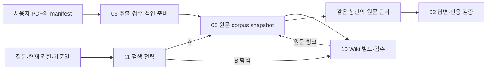

# PDF 원문·Wiki·RAG 설계

## 계층과 역할

PDF가 규정의 원본이다. 파싱한 원문 passage는 검색·인용의 근거다. Wiki는 주제·절차·문서 관계를 사전 정리해 원문을 더 잘 찾기 위한 파생 자료다. 같은 최종 생성 모델이 원문 passage를 받아 답변한다. Wiki의 성능 우위는 실험 전 가정하지 않는다.

## 수집·파싱

파일럿 15~20개로 텍스트/표/FAQ/개정본의 추출을 검증한 후100개로 확장한다. 원본 해시·물리 페이지·block/offset·파서/OCR revision을 보존한다. 청크는 조항의 조건·예외·표 헤더가 연결되도록 만들되 크기·overlap은 실험 설정으로 고정한다. 검색 단위와 문맥 단위를 구분한다. 항·표 행처럼 작은 단위로 찾고, 답변 문맥에는 그 단위가 속한 조문 제목·표 헤더·예외를 support_group으로 함께 넣는다(parent document 방식). 이렇게 넓힌 크기도 공통 token 예산에 포함한다. 임의의 청크 크기를 품질 정답으로 선언하지 않는다. 스캔/표 손상/추출 누락은 검수 보고서에 남기고 무조건 게시하지 않는다.

## 원문 검색

초기 A는 PostgreSQL+pgvector의 exact vector 검색을 기준으로 한다. 임베딩 모델·차원·거리·정규화·후처리 설정을 기록한다. 권한·게시·knowledge_as_of를 제한하고 normative에는 사건 적용 구간을 적용한다. guidance는 공개 시점과 문장 조건/원규정 연결로 검증한다. keyword/hybrid/reranker는 주 실험에 넣지 않는다. 넣을 때는 A/B 공통의 별도 비교 ID로 측정한다([비교 프로토콜](13-retrieval-comparison.md)의 근거 예산·재정렬 절). 총 PDF 수보다 passage 수·처리 시간을 측정한 뒤 인덱스를 판단한다.

## Wiki 생성·게시

MOD-10은 고정 원문 snapshot에서 주제/절차 page와 원문 사이 관계를 생성한다. 주장마다 PDF 판본·페이지·block/span을 연결한다. 단순 요약 외에도 관련 문서와 예외 위치를 탐색할 수 있게 하되 원문에 없는 규칙을 확정하지 않는다. 자동 링크 검사와 사람의 충실성 검수는 별도다.

page는 모든 기여 원문의 접근 권한 교집합을 적용한다. 권한이 다른 내용을 섞어 공개 등급을 낮추지 않는다. 같은 corpus·원문 hash·빌드 설정으로 만든 Wiki snapshot만 사용한다. 개정/철회로 stale이면 새 원문과 결합하지 않는다. 주 실험 B는 A와 같은 임베딩/거리의 Wiki exact vector 탐색을 쓴다. keyword/hybrid와 온라인 추가 LLM 탐색은 별도 후속 실험이다.

## 두 검색 경로

| A 원문 RAG | B Wiki 보조 원문 RAG |
|---|---|
| 질문→허용 원문 검색→공통 정렬/예산 | 질문→허용 Wiki 후보→원문 링크 확장→공통 정렬/예산 |
| 원문 passage를 답변 모델에 전달 | 동일 형식의 원문 passage만 답변 모델에 전달 |
| Wiki 호출 없음 | Wiki 탐색 진단·구축 비용 별도 기록 |

초기 후보는 A 원문20/B Wiki5→확장 원문20, 최종 개수 고정 상한 없이 초기4000 token이다. 예산은 dev 예산 스윕으로 정해 holdout 전에 동결하고, 패킹 순서도 설정으로 고정한다. 공통 정렬·동일 검색 채널·dev 조정과 holdout 동결, 전체 문맥 기준선은 [비교 프로토콜](13-retrieval-comparison.md)이 기준이다. 한 질문이 두 시점을 비교하면 각 검색의 날짜·인용을 구분하고 총 실행 예산도 지킨다. B가 원문을 놓친 경우도 결과로 남긴다. 운영 raw fallback과 엄격 실험은 분리한다.

## 시점·충돌·근거 부족

사건 없는 현재 질문의 기본만 run 수락일이다. 교육/출장 질문은 교육 시작일·출장 시작일 등 원문이 정한 사건 날짜의 판본을 적용한다. 날짜가 없으면 되묻고 복수 사건은 별도 검색한다. 과거 사건의 규범은 해당 시행 구간 판본이며, 현재 공개된 FAQ 해설을 함께 회수할 수 있다. 날짜 두 축과 예정 사건 지원은 사건 날짜 계약을 따른다. 문서의 업로드일·제목에 적힌 현행만으로 결정하지 않는다. 유효기간 공백/누락 조건/모순은 충분한 근거 없음으로 처리한다. 문서 관계/위임에 따른 우선순위가 주어지지 않으면 양쪽 원문을 표시하고 임의로 우열을 정하지 않는다. 답을 모른다는 응답도 평가 대상이다.

날짜 근원과 MOD-02→11 입력·추가 확인 결과는 [사건 날짜 계약](contracts/02-business-dates.md)을 따른다. 판본 필터 이후에도 비교표의 열·종전 과정·연간 누계 등 문장 수준 조건을 보존한다. 날짜가 미확정이면 CT-14 needs_clarification이며 검색0건으로 처리하지 않는다.

## 출처와 재열람

서버가 원문 DTO에서 문서명·version·시행 구간·실제 PDF 페이지·인용문·보호된 URL을 만든다. 모델 citation ID를 근거 원장과 대조한다. PDF/근거 HTTP는 매번 현재 권한을 확인한다. 권한을 잃은 과거 답변은 대화 이력·화면 캐시·모델 문맥에서도 가린다.

## 파싱 수락 기준 — M3 게시 게이트

MOD-06은 page별 원문 blocks와 정규화 텍스트의 offset 대응표를 보존한다. 페이지 끝에서 잘린 조항은 다음 페이지의 같은 절/번호를 확인한 경우만 연결하고 page_spans를 모두 남긴다. 연결 후보/거절/검수 결과를 파일·페이지 쌍별로 기록한다. 검토에서 언급된 경계22곳은 파일럿 점검 목록으로 확정한 뒤 수를 보고하며 미확인 상태에서 통과 수치로 쓰지 않는다.

한국어 줄바꿈은 일괄 공백 삽입/삭제하지 않는다. 원문 줄·좌표를 보존하고 띄어쓰기 정규화 전후를 샘플 대조한다. 금액/날짜/조항/고유명사 일치, 원문 인용 역추적을 필수 검사한다. 표는 제목·열/행 헤더·셀·주석을 연결해 중복 금액의 조건을 복원한다. 종전/현행 열이 구별되지 않으면 needs_review다. 빈 양식은 페이지/양식 제목·필드명만 기록하고 빈 칸을 사실로 색인하지 않는다. 이미지 전용/추출 실패는 OCR 검수 또는 미게시이며 조용히 생략하지 않는다.

안내 개정 쌍·경과조항·원규정 공백과 다중 검색 병합은 [검색 조립 계약](contracts/05-retrieval-assembly.md)의 공통 경로를 A/B에 적용한다.
