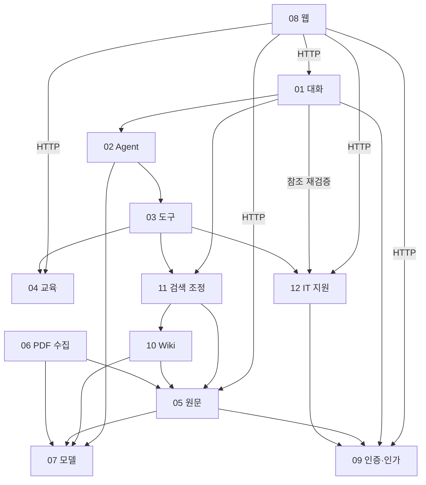

# 모듈 지도와 소유권

## 12개 모듈

| ID | 책임 | 상세 |
|---|---|---|
| MOD-01 | 대화·실행 수락/완료·메시지·필수 도구 기록 | [대화](../modules/MOD-01-conversation.md) |
| MOD-02 | Agent 반복·예산·문맥·근거 원장·최종 결과 후보 | [실행](../modules/MOD-02-agent-runtime.md) |
| MOD-03 | 도구 등록·스키마·분배·한 번 실행·인용 ID | [도구](../modules/MOD-03-tool-execution.md) |
| MOD-04 | 교육 날짜·목록·상세·개발 fixture | [교육](../modules/MOD-04-training.md) |
| MOD-05 | PDF 원본·판본·구간·원문 검색·ACL 바인딩·corpus 게시 | [원문](../modules/MOD-05-knowledge.md) |
| MOD-06 | PDF 검증·추출·분할·임베딩 준비·수집 보고서 | [수집](../modules/MOD-06-ingestion.md) |
| MOD-07 | 채팅·구조화 생성·임베딩 SDK·오류·usage 정규화 | [모델](../modules/MOD-07-model-integration.md) |
| MOD-08 | 대화·PDF 출처·교육·티켓 확인 화면 | [웹](../modules/MOD-08-chat-ui.md) |
| MOD-09 | 사용자·부서·역할·세션·접근 판정·권한 개정 번호 | [인증·인가](../modules/MOD-09-identity-access.md) |
| MOD-10 | Wiki 주장·원문 링크·빌드·검수·게시·갱신 | [Wiki](../modules/MOD-10-wiki.md) |
| MOD-11 | A/B 검색 전략·위키 탐색→원문 확장·시점·검색 진단 | [검색 조정](../modules/MOD-11-retrieval.md) |
| MOD-12 | IT 티켓·등록 준비·확인·멱등성·감사 | [IT 지원](../modules/MOD-12-it-support.md) |

## 허용된 직접 의존

| 호출자 | 직접 호출 가능한 모듈 | 주된 금지 접근 |
|---|---|---|
| MOD-01 | 02, 09, 11, 12 | 모델 SDK·타 모듈 DB·티켓 생성 |
| MOD-02 | 03, 07, 주입 CT-11 observer·CP-07 읽기 포트 | 대화 DB·01 구체 구현 import·확인 API |
| MOD-03 | 04, 11, 12, MOD-02가 넘긴 CT-11 observer | 등록되지 않은 코드·SQL·URL·문서 게시 |
| MOD-04 | 없음 | 대화·문서 DB·LLM |
| MOD-05 | 07, 09 | Wiki·대화·티켓 DB |
| MOD-06 | 05, 07 | 문서 테이블 직접 갱신·Wiki 게시 |
| MOD-07 | 없음 | 업무 판정·업무 DB |
| MOD-08 | HTTP로 01, 04, 05, 09, 12 | 서버 키·DB·SDK·권한 판정 |
| MOD-09 | 없음 | 문서/티켓 DB에서 임의 자원 조회 |
| MOD-10 | 05, 07 | 원문 수정·권한 우회·최종 답변 생성 |
| MOD-11 | 05, 10 | 원문/Wiki 저장소 직접 접근·권한 우회 |
| MOD-12 | 09, 주입 CP-06/07 읽기 포트(모듈 구현 import 아님) | 대화 DB 직접 읽기/쓰기·계정/VPN 변경 실행 |

MOD-10·11은 MOD-05의 현재 접근 판정 계약을 통해 권한을 확인한다. MOD-04의 교육 fixture는 최종 MVP에서도 로그인 사용자에게 공개된 일정이다. 문서 제한 정책과 혼동하지 않는다. ExecutionObserver·자원 가시성·CP-06 RunEligibility·CP-07 ConversationEvidenceReader는 추상 계약이며 저장소 소유권을 바꾸지 않는다. CP-06은 MOD-01의 읽기 어댑터를 앱이 MOD-12에 주입한다. CP-07도 MOD-01 어댑터를 APP-02가 MOD-02/12에 주입한다. MOD-12가 MOD-01 구현을 import하거나 대화 테이블을 직접 읽지 않는다. MOD-03은 CT-11로 MOD-04의 실제 교육 결과 receipt를 기록하고 MOD-02는 CP-07로 날짜를 대조한다.

## 데이터·트랜잭션 소유권

| 데이터 | 단일 쓰기 소유자 | 원자적 작업 |
|---|---|---|
| conversations/messages/message_receipts/agent_runs/tool_calls/tool_result_receipts | MOD-01 | 멱등 질문 수락, 완료/실패/만료·회수, 도구 기록 |
| trainings | MOD-04 | 개발 fixture 적재 |
| logical_documents/editions/source_files/blocks/chunks/embeddings/corpus_snapshots/resource_acl | MOD-05 | 판본 준비 등록, corpus 전환, 자원 ACL 변경 |
| PDF 파싱 작업·준비 산출물/보고서 | MOD-06 | 작업 체크포인트; 문서 게시 커밋은 05 |
| users/departments/memberships/sessions/auth_revision | MOD-09 | 로그인·세션·역할 변경 |
| wiki_pages/claims/source_links/embeddings/builds/snapshots | MOD-10 | Wiki 게시 포인터 전환 |
| tickets/ticket_actions/ticket_action_heads/ticket_prepare_receipts/idempotency_records/ticket_audit/support_scopes | MOD-12 | 수정 교체·확인 소비+티켓+응답 기록+감사, 지원 범위 적재 |
| 실행 문맥·근거·도구 예산 | MOD-02 일시 상태 | DB 쓰기 없음 |
| A/B 검색 중간 결과 | MOD-11 일시 상태 | DB 쓰기 없음; 진단은 run에 전달 |

동일 DB라는 이유로 다른 모듈 테이블을 갱신하지 않는다. 외래키·식별자 참조는 허용하되 조회는 공개 계약을 사용한다. 티켓 확정과 대화 완료는 별도 작업이다. 티켓이 생성되면 대화 저장 실패로 취소됐다고 표시하지 않는다.

## 요구사항 연결

FR-01/02→04, FR-03→02/03, FR-04→01/02, FR-05→05/06/11, FR-06→01/02/07, FR-07→08, FR-08→APP-01~04, FR-09→05/06, FR-10→09와 자원 소유자, FR-11→05/11, FR-12→10, FR-13→11/APP-04, FR-14/15→12/08. 상세 모듈 문서의 테스트 항목이 [검증 카탈로그](../07-test-and-evaluation.md)에 연결된다.
